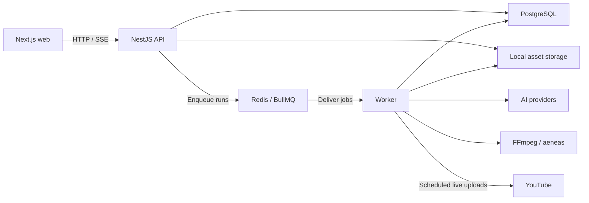

# ReelForge

ReelForge is an AI production pipeline for YouTube Shorts. It turns a channel brief into a script and shot plan, generates keyframes with Gemini image models, and generates clips with Gemini Omni Flash. xAI Grok Imagine is the clip fallback when a pre-dispatch outage is confirmed and the fallback fits the budget. Gemini generates narration and music. ReelForge aligns captions to the narration locally and uses FFmpeg to assemble a vertical H.264/AAC video with burned-in captions. The Short then goes through review and approval before it can be scheduled and published.

Run and workspace budget caps govern paid calls. A PostgreSQL ledger records reservations and outcomes so uncertain submissions can be reconciled before another paid attempt. YouTube publishing defaults to dry-run. AI generation still uses configured providers and can incur charges.

## Architecture and project structure



| Path                                                 | Responsibility                                                                               |
| ---------------------------------------------------- | -------------------------------------------------------------------------------------------- |
| `apps/web`                                           | Next.js studio for briefs, generation, review, and publishing. Proxies `/api/v1` to the API. |
| `apps/api`                                           | NestJS HTTP API, domain services, and pipeline handlers shared with the worker.              |
| `apps/worker`                                        | BullMQ VideoRun consumer, recovery, and background discovery, notifications, and publishing. |
| `packages/contracts`, `packages/database`            | Shared schemas and types, Prisma client, and PostgreSQL migrations.                          |
| `packages/ai-providers`, `packages/social-providers` | AI adapters and social platform connectors.                                                  |
| `packages/config-engine`, `packages/media`           | Configuration and prompt resolution, media utilities, and FFmpeg helpers.                    |
| `packages/observability`, `packages/shared`          | Logging, metrics, tracing, and shared utilities.                                             |
| `docs/`, `work-packages/`, `prompts/`                | Architecture, decisions, work assignments, and contributor workflows.                        |
| `.github/workflows/`, `scripts/`, `e2e/`             | CI, repository checks, and end-to-end tooling.                                               |

## Prerequisites

- **Node.js >=24.22 and <25** (reference version 24.22.2) and **pnpm 12.16.1**, pinned in [.node-version](.node-version) and [package.json](package.json).
- **PostgreSQL 17.12+** and **Redis 8.0.2+**. CI uses PostgreSQL 18.6 and Redis 8.2.3. Configure the database role or server timezone as UTC for API and worker sessions. Check `SHOW TimeZone` on both connection URLs. Channel publishing timezones are independent. Redis is needed to dispatch and process VideoRuns. Docker is optional for running the local services and required by the end-to-end runner.
- **FFmpeg and FFprobe** with a build that includes the `libx264` and `aac` encoders and the `subtitles` filter (libass). Install fonts that cover your caption languages.
- **Python 3** with **aeneas 1.7.3.0** and **eSpeak** with voice data on `PATH` for local forced alignment. Set `ALIGNMENT_PYTHON_PATH` to the interpreter that has aeneas installed if it differs from `python3`. For a tested installation use a Python 3.10 venv, NumPy 1.26.4, setuptools 59.8.0 and the no-build-isolation recipe in the media runtime guide. The API and worker check the local media tools at startup. [Media runtime details](apps/api/src/modules/scene-media/MEDIA_PIPELINE.md)

## Quick start

Run these steps from the repository root.

1. Install the workspace dependencies.

   ```sh
   pnpm install --frozen-lockfile
   ```

2. Copy the environment template on first setup and edit your local copy. Keep credentials in your local environment.

   ```sh
   cp .env.example .env
   ```

   These variables are listed in [.env.example](.env.example).

   | Variables                                                                                                                    | Purpose                                                                                                                             |
   | ---------------------------------------------------------------------------------------------------------------------------- | ----------------------------------------------------------------------------------------------------------------------------------- |
   | `DATABASE_URL`, `DIRECT_DATABASE_URL`                                                                                        | PostgreSQL connection. Set the direct URL to a session-mode endpoint when the primary URL uses transaction pooling.                 |
   | `API_TRUSTED_PROXIES`                                                                                                        | IPs or CIDRs of proxies trusted to supply client addresses.                                                                         |
   | `STORAGE_DRIVER`, `STORAGE_LOCAL_ROOT`, `ASSET_MAX_BYTES`                                                                    | Select the local filesystem storage driver, its root, and the upload size limit. Share the storage root between the API and worker. |
   | `REELFORGE_API_ORIGIN`, `WEB_APP_ORIGIN`                                                                                     | API origin for the Next.js proxy and browser origin for OAuth returns and origin checks.                                            |
   | `GEMINI_API_KEY`, `XAI_API_KEY`, `PROVIDER_KEY_ENCRYPTION_KEY`                                                               | Environment credentials for generation and the encryption key for workspace-managed provider credentials.                           |
   | `GEMINI_TEXT_MODEL`, `GEMINI_IMAGE_MODEL`, `GEMINI_VIDEO_MODEL`, `GEMINI_TTS_MODEL`, `GEMINI_MUSIC_MODEL`, `XAI_VIDEO_MODEL` | Model IDs for planning text, keyframes, clips, narration, music, and clip fallback.                                                 |
   | `OPENAI_API_KEY`, `OPENAI_TEXT_FALLBACK_ENABLED`, `OPENAI_TEXT_MODEL`                                                        | Optional OpenAI fallback configuration for supported text calls.                                                                    |
   | `PIPELINE_V2`                                                                                                                | Legacy rollout flag unused by the current VideoRun pipeline.                                                                        |
   | `YOUTUBE_OAUTH_CLIENT_ID`, `YOUTUBE_OAUTH_CLIENT_SECRET`, `YOUTUBE_OAUTH_CALLBACK_URL`                                       | Google OAuth credentials and redirect URI for connecting a YouTube account.                                                         |
   | `SOCIAL_TOKEN_ENCRYPTION_KEY`, `PUBLISH_SESSION_ENCRYPTION_KEY`, `PUBLISH_DRY_RUN`                                           | Protect stored OAuth tokens and upload sessions, and control whether publishing uploads to YouTube.                                 |
   | `RESEND_API_KEY`, `ACCOUNT_EMAIL_FROM`, `ACCOUNT_EMAIL_RELAY_URL`, `ACCOUNT_EMAIL_RELAY_TOKEN`                               | Optional account email delivery through Resend or an authenticated HTTPS relay.                                                     |

   Set `WEB_APP_ORIGIN` to `http://localhost:3000` for local browser requests. Add `REDIS_URL` for VideoRun queues and progress events and point it at your local Redis instance. Add `ALIGNMENT_PYTHON_PATH`, `FFMPEG_PATH`, or `FFPROBE_PATH` when you need to select specific local executables.

   Export your local settings in each Bash terminal before running commands.

   ```bash
   set -a
   source ./.env
   set +a
   ```

3. Start PostgreSQL and Redis. Use existing local services or start containers with the same images as the end-to-end runner. These Docker examples bind the services to loopback and use local-only database credentials.

   ```sh
   docker run --detach --name reelforge-postgres -e POSTGRES_USER=postgres -e POSTGRES_PASSWORD=postgres -e POSTGRES_DB=reelforge -p 127.0.0.1:5432:5432 postgres:18.6-alpine
   docker run --detach --name reelforge-redis -p 127.0.0.1:6379:6379 redis:8.2.3-alpine
   ```

   The Redis container is reachable at `redis://127.0.0.1:6379/0`. If PostgreSQL port `5432` is occupied, use `127.0.0.1:55434:5432` as the port mapping and update the host port in `DATABASE_URL`. Re-export any changed settings before proceeding.

4. Once PostgreSQL is ready, apply the committed migrations and build the API, worker, and their workspace dependencies. The database build generates Prisma Client. Create your account and workspace in the studio after startup. There is no seed script.

   ```sh
   pnpm db:migrate:deploy
   pnpm --filter '@reelforge/worker...' build
   ```

5. Start each app in its own terminal with the environment exported.

   | App    | Command                                 | Default address                |
   | ------ | --------------------------------------- | ------------------------------ |
   | API    | `pnpm --filter @reelforge/api start`    | `http://localhost:3001/api/v1` |
   | Worker | `pnpm --filter @reelforge/worker start` | No HTTP listener               |
   | Web    | `pnpm --filter @reelforge/web dev`      | `http://localhost:3000`        |

   Open the studio, create a channel, and set up its brief. Configure generation credentials through the environment or **Settings → Provider keys**. Workspace-managed keys require `PROVIDER_KEY_ENCRYPTION_KEY`, a 32-byte key encoded as base64url. Keep the model IDs from the template configured for the provider runtime.

## Generation costs and discovery

The media pipeline enforces a 30–45 second target. Example primary-route estimates for 30 and 45 seconds are $3.05 and $4.13 respectively, with base budgets around $3.62 and $4.93 including receipt headroom. Shot count, routing and reshoots change the total. New Briefs start at 45 seconds with a $5 target and $5.50 hard cap. Workspace and Brief daily/monthly limits both apply.

Set `PAID_TEXT_V3_ENABLED=1` on the API and worker to enable journaled paid text dispatch for VideoRun planning and critique. The default is off. With the flag unset or set to `0`, dispatch is refused before contacting the provider and the attempt closes at zero cost.

Scheduled discovery is opt-in. Set `DISCOVERY_ENABLED=true` and configure a positive `DISCOVERY_TEXT_ESTIMATE_USD` in major USD per grounded text request. Discovery can use YouTube search and paid Gemini text independently of a Short, under workspace budgets.

## YouTube publishing

`PUBLISH_DRY_RUN=true` is the default, including when the variable is unset. After preflight, a dry run records completion locally without uploading or assigning a remote video ID. Automatic scheduling still needs a healthy YouTube account connected to the channel.

1. Enable the YouTube Data API v3 for your Google Cloud project and configure a web OAuth client. Register the exact redirect URI configured in `YOUTUBE_OAUTH_CALLBACK_URL`. The local template uses `http://localhost:3001/api/v1/social-accounts/oauth/youtube/callback`.
2. Set `YOUTUBE_OAUTH_CLIENT_ID`, `YOUTUBE_OAUTH_CLIENT_SECRET`, and `WEB_APP_ORIGIN` for the studio return. Supply `SOCIAL_TOKEN_ENCRYPTION_KEY` for stored OAuth tokens and `PUBLISH_SESSION_ENCRYPTION_KEY` for resumable uploads. Each key is 32 bytes encoded as base64url.
3. With those settings loaded, connect the channel in **Settings → YouTube connection** and grant the requested `youtube.upload` and `youtube.readonly` scopes.
4. When ready to upload, set `PUBLISH_DRY_RUN=false` and restart the API and worker with the updated environment. Publish an approved Short through the studio. The automated publishing flow submits live uploads as private videos.

## Toolchain and checks

- **Studio:** Next.js App Router uses Turbopack for development and production builds.
- **API, worker, and shared packages:** SWC compiles TypeScript to Node.js ESM. TypeScript still checks types and emits package declarations. The build checks that the generated artifacts include working source maps.
- **Quality and tests:** Oxlint checks code and Oxfmt formats it while preserving intentional single blank lines. Vitest runs unit and integration tests. Playwright runs end-to-end tests, with Rspack used only for the standalone browser fixtures.

| Command                    | Purpose                                                               |
| -------------------------- | --------------------------------------------------------------------- |
| `pnpm lint`                | Run Oxlint with warnings treated as failures.                         |
| `pnpm format`              | Apply Oxfmt formatting.                                               |
| `pnpm format:check`        | Check Oxfmt formatting and run toolchain configuration tests.         |
| `pnpm typecheck`           | Run workspace TypeScript checks and generate Prisma Client.           |
| `pnpm test`                | Run Vitest unit and integration tests.                                |
| `pnpm test:e2e`            | Run Playwright end-to-end tests with disposable Docker services.      |
| `pnpm db:validate`         | Validate the Prisma schema.                                           |
| `pnpm db:check-migrations` | Check migration policy against `origin/main` or `MIGRATION_BASE_REF`. |
| `pnpm build`               | Build the workspace and verify the generated artifacts.               |

Use a disposable migrated PostgreSQL database and run `pnpm db:generate` for integration tests. Redis and FFmpeg tests have their own service or executable requirements. Export `DATABASE_URL` for Prisma generation and set an explicit `REELFORGE_API_ORIGIN` for the production build. See the [CI workflow](.github/workflows/ci.yml) and [full-suite reliability workflow](.github/workflows/full-suite-reliability.yml).

## Troubleshooting

| Symptom                                                 | What to check                                                                                                                                                                                                            |
| ------------------------------------------------------- | ------------------------------------------------------------------------------------------------------------------------------------------------------------------------------------------------------------------------ |
| Prisma cannot find `DATABASE_URL` or connect            | Export the environment in this terminal. Check the mapped host port, database name, and credentials. For missing tables, run `pnpm db:migrate:deploy`.                                                                   |
| API or worker cannot find `dist/main.js`                | Run the workspace build from step 4, then restart the process.                                                                                                                                                           |
| API or worker fails the local media preflight           | Check that the selected Python imports aeneas, that eSpeak and the narration voice are installed, and that FFprobe and FFmpeg with libass are available. Restart after fixing executable paths or installing voice data. |
| Runs stay queued or the worker cannot connect           | Check that both processes have the same reachable `REDIS_URL` and inspect `http://localhost:3001/api/v1/health` for queue and database status.                                                                           |
| Studio requests fail or OAuth returns to the wrong host | Match `REELFORGE_API_ORIGIN` to the API listener and `WEB_APP_ORIGIN` to the studio. Verify the exact callback URI registered in Google Cloud.                                                                           |
| Generation or publishing is blocked                     | Check provider credentials, model IDs, budget headroom, and review state. For publishing, check the connection and preflight gates. A dry-run completion creates no YouTube video.                                       |

## Contributing

Branch from `main`, open one PR per issue, and keep changes within the assigned work package. Link the issue, record actual check results, and ensure **Required CI** is green on the PR head before integration. Shared contracts, schema and migrations, and root tooling are Core-owned. Leave approval and integration to the authorized reviewers. See [CONTRIBUTING.md](CONTRIBUTING.md), [AGENTS.md](AGENTS.md), and the [AI editor protocol](docs/AI_EDITOR_PROTOCOL.md).

### Source-of-truth order

Resolve conflicts in this order. New architectural or product decisions require approval from the Core Architect/Reviewer and project owner and a record in the decision log.

1. [Decision log](docs/DECISION_LOG.md)
2. [Project charter](docs/PROJECT_CHARTER.md)
3. [Architecture baseline](docs/ARCHITECTURE_BASELINE.md)
4. [Pipelines](docs/PIPELINES.md)
5. [Module catalog](docs/MODULE_CATALOG.md) and the assigned [work package](work-packages/)
6. [Project state](docs/PROJECT_STATE.md)
7. [Work log](docs/WORK_LOG.md)
